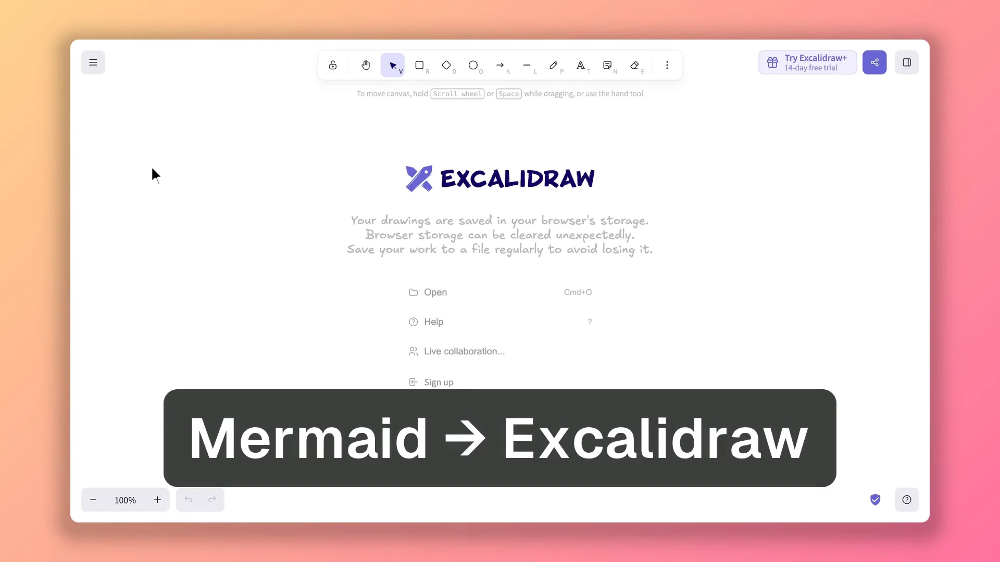

# DemoCut skill

Your coding agent makes the demo video. This skill lets Claude Code, Codex and other agents record your app in [DemoCut](https://democut.app), edit it and export an MP4.

[](examples/excalidraw-mermaid/excalidraw-mermaid-demo.mp4)

Made by Claude Code with DemoCut from one prompt, with no edits by hand:

> Make a short demo of Excalidraw’s Mermaid tool.

## Install

```sh
curl -fsSL https://democut.app/install.sh | bash
```

This installs DemoCut on your Mac and adds the skill to Claude Code and Codex. Then paste this into your agent:

> Make a 30-second demo video of &lt;your app&gt; with DemoCut.

The skill drives the DemoCut app, so install the app first. To add only the skill:

- Claude Code: `claude plugin marketplace add democut/democut`, then `claude plugin install democut@democut`
- Codex: `codex plugin marketplace add democut/democut`
- Other agents: `npx skills add democut/democut`

## Free and Pro

Free makes walkthrough demos with zooms, captions and a short DemoCut end card. Pro removes the card and adds narration. See [democut.app/pricing](https://democut.app/pricing).

## What's here

`skills/democut/` holds the skill (`SKILL.md`) and the two guides it reads: `TASTE.md` for walkthroughs and `LAUNCH.md` for launch films. These files are the same as the copy inside the app, synced on each DemoCut release.

## License

MIT for the files in this repository. The DemoCut app is not open source.
